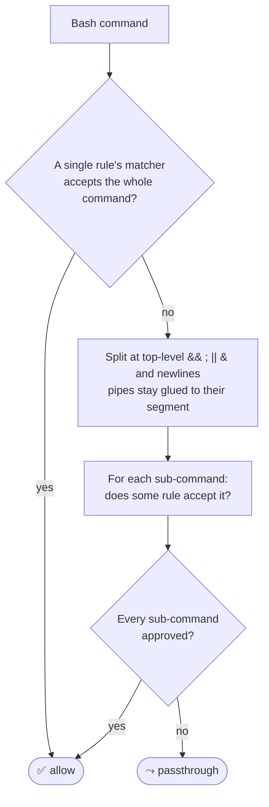

# anumati

**Stop approving the same Bash commands over and over.** anumati is a
deterministic **auto-approver** for AI coding agents. From a small config of
**named matchers** it auto-allows _safe_ shell commands — so `git status`,
`npx tsc`, `cargo test`, `jq`, and friends just run, while genuinely risky
commands still get a prompt. It's **agent-agnostic**: one shared config drives
both [Claude Code](https://code.claude.com) (via its `PreToolUse` hook) and
[OpenAI Codex](https://developers.openai.com/codex) (via its `PermissionRequest`
hook).

When something falls through, anumati tells you the exact one-liner to allow it
next time — so your config **builds itself from real usage**.

```
$ git status && cargo test | tail -20
  ✓ auto-approved (no prompt)

$ terraform apply
  ⤳ prompt shown  ·  💡 anumati: no matcher covers "terraform"
```

## Why anumati

- **Deterministic, not vibes.** Approval is decided by explicit matchers with a
  strict grammar — not an LLM guessing whether a command is safe. The same
  command always gets the same answer.
- **Safe by construction.** Matchers allow only read-only / build / test shapes.
  Redirects that write files, `$(...)` substitution, network `curl` to unlisted
  domains, `git push`, `rm` — all fall through to a real prompt. anumati is
  **allow-only**: it can approve a call or step aside, but never blocks anything
  itself, and never widens what the agent would otherwise refuse.
- **Composes across a whole command line.** `git status && cargo build | tail`
  is approved only if _every_ piece is independently safe — you can't smuggle
  `rm -rf /` in by chaining it onto an allowed command.
- **Self-building config.** Every passthrough comes with a verified suggestion
  (`anumati add …`) and a logged reason, so you extend coverage from what you
  actually run.
- **Bash-only by design.** anumati vets `Bash` — the hard problem. `Read` /
  `Write` / `Edit` stay with the agent's own permission flow.

## How it works

Every time the agent is about to run a **Bash** command, anumati checks it
against your allow rules:

1. **A rule matches** → auto-approved, no prompt.
2. **No rule matches** → the agent shows its normal permission prompt, and
   anumati prints a 💡 suggestion for allowing it next time.

A command is approved one of two ways: a single matcher accepts the whole thing,
or — failing that — anumati splits it at top-level `&&`, `;`, `||`, `&`, and
newlines and approves only if **every** sub-command is independently accepted.



A disallowed sub-command always fails its own check, so chaining a bad command
onto a good one can't sneak it through. Pipes are never split across rules (a
pipe feeds data into the next command, so only the matcher owning the pipeline
can judge it). Configs cascade: a project config at
`<cwd>/.anumati/permissions.json` is checked before your global
`~/.anumati/permissions.json` (the legacy `~/.claude/` locations are still
honored, so existing setups keep working).

The full model — matchers, composition rules, and safety guarantees — is in
[`docs/CONFIGURATION.md`](docs/CONFIGURATION.md).

## Install

```bash
npm install -g anumati
```

Or run without installing via `npx anumati ~/.claude/permissions.json`.

Update to the latest version any time with `anumati update` (it checks the
published version and, if newer, runs the global reinstall for you; the hook
picks it up on the next command). `anumati update --check` just reports whether
a newer version exists.

## Quick start

One command sets up everything:

```bash
anumati init
```

It prompts for **which agent(s)** (Claude Code / Codex / both) and **project**
(this folder) or **root** (global) scope, then:

1. **Writes a starter config** of broadly-useful, low-risk rules — read-only
   inspection, git reads, `cd`/`sleep`/`echo`/`sed`/`jq`, `npx tsc`, `cargo`,
   `go`, test runners (`vitest`/`pytest`/`jest`), and pure-compute
   `python3`/`node`. Enough to be useful immediately. It also seeds the
   parameterized matchers (`curl`, `gh`, `pip3-install`, `git-write`,
   `git-push`, `node-script`) as **inert placeholders** — empty allowlists that
   approve nothing until you fill them in, so you can see the matcher exists and
   which key to populate (`anumati add <matcher> …`) without hunting the docs.
2. **Scaffolds an audit log** next to the config.
3. **Wires the chosen agent(s)**, merged non-destructively — Claude Code's
   `PreToolUse` hook in `settings.json`, and/or Codex's `PermissionRequest` hook
   in `~/.codex/hooks.json`.
4. **Adds a SessionStart banner** ("⚡ anumati active") so you can see it's on.
5. **Writes command-style guidance** to the sibling `CLAUDE.md`, nudging the
   agent to emit approvable commands.

**Reload the agent** for it to take effect (Claude Code: `/hooks` or restart;
Codex: approve the anumati hook once when it prompts to review it). Then just
work — routine commands stop prompting, and when something new falls through
you'll see a `💡 anumati add …` suggestion.

Grow your config as you go:

```bash
anumati add curl --domain api.github.com   # allow curl to a domain
anumati add git-write --git-ops add,commit  # allow specific git writes
anumati stats                               # see your auto-approve rate
anumati apply --all                         # apply accumulated suggestions
```

## Docs

- **[Configuration reference](docs/CONFIGURATION.md)** — every matcher, rule
  field, audit/sound/debug option, and CLI subcommand.
- **[Claude Code + Codex](docs/MULTI-AGENT.md)** — running anumati across both
  agents from one shared config: per-agent wiring, the Codex integration, and
  `anumati migrate`.
- **[Command-style guide](docs/COMMAND-STYLE.md)** — how to write commands that
  land on the auto-approve path (also installed into `CLAUDE.md` by `init`).

## Contributing

See [`CONTRIBUTING.md`](CONTRIBUTING.md) for local setup — including running
Claude Code against your local build via `npm link` — plus how to test, add a
matcher, and open a PR.

## License

MIT
